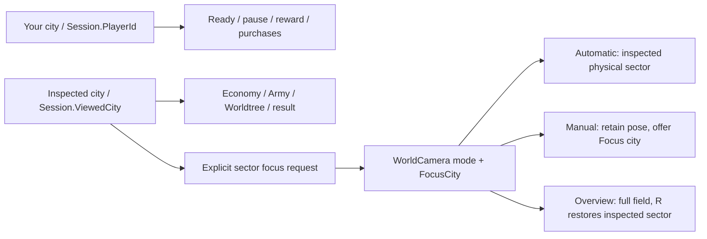

# Cooperative context — issue #20 (in progress)

Core source, authority, enemy redistribution, elimination and reward rules are
unchanged. The Shared team projection now states the existing connected-standing
barrier and distinguishes current participation from surviving field members in
reward waiting. A confirmed local choice awaiting its inventory snapshot is
Syncing, not still Choosing. These are presentation facts, not new quorum rules.

Team status uses retained native city buttons, compact boundary counts, visible
exception groups and optional bounded details. Two/four-player layouts use two
columns; five/six use three. Low Keep, field/stored funding, empty army, Away and
Fallen remain visible without hover. Inspecting an ally never changes command
ownership. The expanded disclosure exposes actual HP, physical contributions,
required players and read-only Army/Worldtree routes. Ordinary accepted actions
already coalesce by kind/city/slot and exact command sequence; rejected/disconnected
notices and actual team exceptions keep their existing persistent routes.

| Previous default surface | Current primary home / retained route |
| --- | --- |
| Every city repeats healthy HP, field count and funded text | City identity/state stays visible; exact healthy details move into the bounded disclosure. Low Keep, funding exceptions and empty field stay visible. |
| Three equal-height roster rows for six cities | Two rows of three compact native city targets, with no loss of city navigation. |
| No explicit physical camera mode in Team | The existing heading reports inspected sector, Manual or Overview; Focus appears only for the latter two. One disclosure trigger replaces the static heading. |
| Ally Army/Worldtree reached through general planning navigation | Optional Team disclosure supplies the same read-only inspection during combat/observation. |
| Overview, details, speeds, paused status and Pause stack vertically | Two action rows retain the same six combat controls. PAUSED shares the phase heading; noncombat paused status remains visible. |
| Fallen city remains a manual observation destination | One deferred automatic ally choice plus retained own-city/ally/manual routes; no recurring health-driven camera changes. |

For six healthy cities the Team surface still has six city controls and adds one
deliberate disclosure trigger; its repeated detail and three-row footprint shrink.
Manual/overview adds one contextual Focus control, not another permanent panel.
This is an information and layout consolidation, not a claim that every local
surface has fewer clickable targets. The phase-wide control subtraction is
recorded in the #16 inventory.

Selecting a city explicitly focuses its sector and clears the old live selection.
The own-city button returns locally; R restores the current inspected sector;
F retains inspection while showing the complete field. Manual gestures persist
through unrelated snapshots. Camera focus uses playback cells for current actor
membership, including help crossing sectors; destination is only a fallback for
actors with no accepted position. No snapshot, actor motion or health change
periodically reframes the camera. The Menu occluder is its actual button, not
unused HBox space (the HBox already ignores pointer input).

The inspected city persists across battle entry. An explicit city selection during
combat supersedes the earlier harmless planning return. Reconnect baselines retain
inspection and an existing live pose; a new battle/size/projection still establishes
its ordinary default. These refinements preserve the existing HudJourney owner
for screen transitions. ObserverSelection is only a bounded navigation preference.

A fallen player can inspect their own surviving troops or living allies. The
one automatic observer choice waits for their currently presented survivors and
an automatic camera, and uses the lowest-health connected standing ally, then ID;
standing away allies are the fallback. Explicit inspection or camera navigation
wins thereafter. Health updates cannot chase a new suggestion. Disconnection
keeps the reconnect route; terminal states offer no future Ready/reward/recovery.
Host exit retains the existing explicit whole-session warning and lifetime.

Baseline probe `2bba5fd` observes source `cb8d787` (#19). Before geometry and legal
2–6-player cases at both sizes: `artifacts/captures/cooperation-review/before`.
Normal six-player wave-six before captures are under
`artifacts/captures/combat-review/r10-before`, with 270 actual ticks in both cases;
wall time was about 9.05/14.02 seconds on software rendering. They are ordinary
1x combat after accelerated paid setup, not human or hardware pacing evidence.
Network interleaving means before/after outcomes are not paired counterfactuals.

First prototype after captures are retained in `after-initial`. They established
all five roster sizes and an actual first-wave fall, but the two-player panel grew
and terminal capture could precede settled UI. Small-group layout and the terminal
capture wait were corrected; final capture work remains in progress.

All eight focused native cooperative three-wave profiles passed before the final
combat-control grouping: 2p default/debug at both sizes, 4p/6p default at both
sizes. Host, P2 and final-guest command owners were exercised. Receipts cover
actual projected sector shift P1→P2, cleared old selection, wheel/pan retained
through real paused speed changes, Focus city, F/R, bounded team disclosure,
allied Army/Worldtree, keyboard/controller local return, slow finishing playback,
delayed acknowledgment and private ready/draft reconnect. Seven complete profiles passed again on the final grouped controls. Six-player
1080p passed focus, then exposed a weak slow-client probe: suppressing Advance
did not stop Playback.Accept from catching up to arriving snapshots. A
development-only hold now delays playback acceptance while authority/RPC receipt
continues and retains only the existing latest snapshot. Release accepts that
snapshot, and admission baselines clear the hold. The repaired six-player 1080p
run passed all three waves, including a held playback tick behind the actual
authoritative reward boundary. Normal acceptance remains unchanged. The final
small-profile rerun and broad native gates are still running.

Eighteen matched native preparing/ready/local-ready boundaries retain exact
phase, command owner and roster. Default panel heights shrink at both sizes:

| Roster | Before | After |
| --- | ---: | ---: |
| 2 | 87 px | 84 px |
| 4 | 146 px | 126 px |
| 6 | 205 px | 147 px |

`python3 tools/compare-cooperative-context.py` validates these paired boundaries.
Real low-Keep, first-wave fall, ally observation and settled Defeat captures also
passed. Artificial capture pauses and accelerated active time are separate in
`receipts.json`; none is reported as human waiting time.

Combat's speeds and Pause/Resume now share one row; Overview and City details
share another. At 720p the routine action frame is 207 px high, previously 336.
The combat frame sits with Team on the left, leaving one broad unobstructed field;
expanded exceptions use the other corner if needed to avoid panel overlap. A
requested default waits one native layout pass before saving its pose. Neither
routine snapshots nor later panel/actor changes invalidate it. In intermediate
captures, reducing height alone and waiting for layout alone did not enlarge
maximum-group figures; the opposing corners remained the limiting geometry.
The final six-player 720p median figure height is 73.5 px, previously 59.8, with
zero initial text/body intersections. At 1080p figures grow from 106.5 to 111.0 px
(4.2%). The comparator passes: >15% gain at the unresolved 720p case, positive
zoom/size and no increased initial label collisions at both sizes. An initial
provisional 5%-at-both-sizes assertion rejected 1080p; that threshold was not a
product criterion. The report retains both actual ratios. Both final encounters
ran 270 ticks at normal 1x; wall time was 8.83/12.88s on software rendering.
These unpaired network outcomes are not causal balance evidence.

The bounded paid observer search found no owned living deployed unit exactly at
its owner's first elimination. Both ordinary family campaigns (54 cases) and
capped weak-army campaigns (81 cases), plus the earlier single-Crossbow cases,
are negative discovery evidence. Sources are retained under
`artifacts/refinement-ii/r10/ObserverCases-*-negative.cs`. They do not qualify a
positive native fallen-owner-survivor checkpoint. The presentation preference
fixtures verify deferral while own survivors exist, one automatic choice,
explicit own/ally choice and session/match reset; they are not campaign captures.
The final native exception worker additionally checks a fallen guest's explicit
own/manual choice through genuine updates and live cross-sector owner/location
inspection. Do not fabricate an authoritative state to fill the rare-case gap.

Pure checks passed: zero-warning locked build, Core 46, Shared 145 and session
models 109. Full native acceptance is still running: final focused matrix,
exception/cross-sector worker, session, gameplay, 1–6 multiplayer, private
reconnect/fault, art, animation, camera and solo journeys. Their final receipts,
source manifest and CI result must be recorded before declaring Gate A.

`mise run test-cooperative-context` runs the eight-profile focus/three-wave
matrix and the legal exception worker. CI runs focused 2p/6p 720p profiles in
addition to existing session, gameplay, solo journey, animation and exports.
The normal framing comparison is `tools/compare-cooperative-framing.py` against
`r10-before` and the final normal-speed capture directory. It compares geometry,
not counterfactual network outcomes.

Gate A remains pending. After these presentation gates, finish the original #25
exact command/event/no-investment archive BEFORE changing any #21 rules.
No physical/human, live Steam or native other-platform qualification is claimed.
The separately recorded intermittent native runtime risk remains unproven.

## Experiential validation

Actual default six-player local-framing PNGs were inspected at 720p and 1080p:
the inspected sector's soldiers, defenses and incoming enemies remain visible,
the two combat action rows fit, and Team retains all six identities. Native
geometry establishes the stated sizes/intersections; scripted input establishes
navigation, ownership and transitions. These are distinct evidence categories.
No participant study, physical controller/audio/GPU trial, comprehension finding
or enjoyment/balance conclusion has been conducted. Accelerated setup and
artificial paused captures do not establish natural decision or spectator time.
