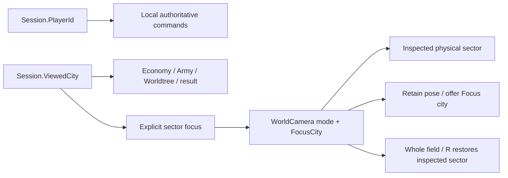

# Cooperative context — issue #20

Command ownership, inspection and camera focus are separate. Selecting an ally
changes inspection and intentionally focuses its physical sector; Ready,
purchases, pause and reward ownership stay with the authenticated local city.
Core rules, enemy allocation, elimination, dependencies, artwork/audio, settings
and the published Session RPC path remain unchanged. Shared changes only its
pure team presentation projection.

## Retained capabilities and consolidation

| Previous surface | Current primary home / retained route |
| --- | --- |
| Every city repeats healthy HP, field count and funded text | Compact identity/state buttons; exact details in a bounded disclosure. Low Keep, sit-outs, stored funding, empty field, Away and Fallen remain visible. |
| Three equal-height roster rows for six cities | Two rows of three native city targets; every city remains selectable. |
| Static Team heading | Ready/Choosing boundary or physical camera context, plus one deliberate disclosure trigger. Focus appears only in Manual/Overview. |
| General planning routes for allied inspection | Optional Team disclosure exposes read-only Army/Worldtree during combat/observation. |
| Overview, details, speeds, paused status and Pause stacked vertically | Two compact action rows retain all six combat controls. PAUSED shares the phase heading; noncombat pause status remains visible. |
| Inactive fallen planning | One deferred automatic ally choice, own-city/ally/manual routes and the existing explicit host-exit warning. |

Six healthy cities still have six city controls and gain one disclosure trigger;
repeated facts and default area shrink. Manual/overview adds one contextual Focus
action. This does not claim every local surface has fewer clickable targets;
the phase-wide control subtraction is recorded in #16.

The existing Core boundary requires connected, standing cities. An accepted
local reward awaiting its inventory snapshot is Syncing rather than Choosing.
A local client still presenting the last battle reads Finishing; teammates may
already be Choosing, Selected or Preparing. Field counts/locations still use
presented units, with the completed upkeep rather than a future forecast. The
phase heading says Finishing combat and unavailable speed actions disappear.
Boundary counts remain authoritative. No new simulation phase, quorum, timeout,
automatic Ready or spectator activity is introduced.

## Navigation and lifetime

City selection clears the old live unit/structure selection and cancels stale
management intent. Focus city and R restore the inspected sector; the own-city
button returns locally. F shows the complete field while retaining inspection.
Manual gestures persist across unrelated snapshots and resource changes. Camera
membership uses actual playback cells, not ownership or intended destination.
Live inspection states both owner and physical sector.

A requested default waits one native layout pass before saving its pose. Only a
new battle, viewed city, viewport/projection or explicit focus invalidates it;
health changes and actor motion do not chase a new frame. Combat controls share
the left side with Team, leaving one broad field. Expanded exceptions use the
other corner if needed to avoid panel overlap. The Menu occluder is its actual
button, not unused HBox space.

The inspected city persists across battle entry. Explicit combat navigation
supersedes the old harmless planning return. Ordinary snapshots preserve manual
pose. Explicit leave/rejoin creates a fresh session at its current phase,
inspecting its authenticated local city; old modals and historical receipts do
not replay. SessionCoordinator retains exclusive lifetime ownership and the
application-root Session child. Typed cross-owner events disconnect on exit;
retained buttons keep old-session/match/visibility guards.

A fallen player's first automatic observation waits for currently presented own
survivors and an automatic camera, then chooses the lowest-health connected
standing ally, with ID breaking ties. Standing away allies are the fallback.
Explicit city/camera navigation wins thereafter. Own surviving troops remain
inspectable; future waves exclude that city. Disconnection retains reconnect;
match terminal states promise no further production, recruitment, recovery or
reward. Leaving as host still requires the existing whole-session confirmation.

## Measured evidence

Baseline probe `2bba5fd` observes #19 source `cb8d787`. Eighteen matched native
preparing/ready/local-ready states retain command owner, phase and roster while
shrinking every default panel at both sizes:

| Roster | Before | After |
| --- | ---: | ---: |
| 2 | 87 px | 84 px |
| 4 | 146 px | 126 px |
| 6 | 205 px | 147 px |

Normal six-player W6 encounters at displayed 1× (factor 0.5), after paid
accelerated setup, show initial median figure heights 59.8 → 73.5 px at 720p
(+22.9%) and 106.5 → 111.0 px at 1080p (+4.2%). Initial text/body intersections
remain zero. The action frame shrinks from 336 to 207 px at 720p. Height reduction
alone and waiting for layout alone did not enlarge figures: opposing corner
panels were limiting. Grouping controls leaves the wider usable field.

The comparator requires >15% growth at the outstanding 720p case and positive
zoom/size with no collision regression at 1080p. A provisional 5%-at-both-sizes
assertion rejected the 4.2% 1080p gain; it was not a product criterion. Both actual
ratios are retained. The final encounters ran 270 ticks; wall time was
8.83/12.88 s on software rendering. Network command interleaving changes IDs and
tie breaks, so these are unpaired geometry observations, not causal outcomes.

Eight final normal-speed solo comparisons preserve exact outcomes and durations
(301/302/271/272 ticks). Relative to the pre-framing baseline, median figures grow
20–26% at 720p and 22–28% at 1080p; initial label/body intersections fall to zero.
All 474 sampled selected-body/target checks avoid the inspector. The added
location line initially clipped Advanced; compact spacing and reserved scrollbar
width now show the complete basic summary and Advanced at both sizes.

Real exception captures inspect a P1 Swordsman in P2 sector, cell 43, at 2.5/40 HP.
Owner and Location remain distinct. The unit inspector uses the development
selection API; team/camera and observer shortcut use native input, separately
qualified. The worker arms crossing capture at combat start and handles crossing,
low Keep and fall pauses in their actual order. A fallen guest's own/manual
choice persists through real updates at both sizes.

The limited/idle session reaches a real first-wave fall and Defeat. The final
focused run records 12.21 s observed spectator wall time, including 6.76 s paused
capture/input work, 5.45 s accelerated active time and 0.003 s presentation-finish
delay. A separate paid frontline/idle campaign reaches W20 Victory with both
cities standing: 41.65 s accelerated scripted wall time includes 3.08 s captures.
Both local owners at both sizes show no new draft, Ready or personal management.
These are not human waiting or normal viewing-time estimates.

## Verification and reproduction

Locked zero-warning build; Core 46 / Shared 145 / session models 109; three native
session process tests; four full default/debug gameplay profiles plus seven paid
remote waves; 1–6-player multiplayer; private reconnect/fault cases; 24 native
arena size/projection cases; 14 art views; animation phases/fallbacks; four native
solo three-wave journeys; and the normal-speed comparisons passed locally.
The cooperative matrix covers 2p default/debug and 4p/6p default at both sizes,
including host, P2 and final guest. Final focused reruns cover the corrected
playback hold, finishing status and phase heading. Actual canvas shifts, cleared
selection, pan/wheel retention, F/R/Focus, bounded disclosures, read-only allied
Army/Worldtree, keyboard/controller return, delayed ACK, slow playback and
ready/draft reconnect are exercised.

`mise run test-cooperative-context` runs the eight-profile focus/journey matrix,
real 2–6-player exceptions and full uneven Victory. CI runs 2p/6p 720p focus,
2p exceptions/Victory and the existing session/gameplay/solo/animation/export
gates. Earlier CI runs 63/65 exhausted the full six-client 360 s process bound;
shutdown StringName diagnostics followed termination. The complete journey now
has a bounded 540 s allowance; per-observation deadlines remain unchanged. This
is not a native-runtime crash fix. Runs 67/69 passed, including both exports;
the PR carries the final revision's checks.

The slow-client probe must hold playback acceptance as well as Advance:
Playback.Accept legitimately catches up to arriving ticks. The development-only
hold keeps receiving authoritative snapshots/RPC receipts, retains only the
existing latest snapshot and feeds it on release. Admission clears the hold.
Native assertions verify a held playback tick behind the real reward boundary;
normal acceptance is unchanged. Camera/normal-capture probes wait for native
layout before measuring a saved pose. An earlier queued shell ended with SIGTERM
after art reported completion; standalone art confirmation and remaining checks
passed. The cause of that shell termination is unconfirmed.

Local artifacts: `artifacts/captures/cooperation-review/` (before, accepted,
final-inspector, final-finishing, shipping, victory and comparisons),
`artifacts/captures/combat-review/r10-{before,final,final-solo}` and
`artifacts/refinement-ii/r10/`. The manifest identifies accepted logs, source
hashes and evidence scopes. Native PNG/geometry use actual pixels; optional
half-scale video proxies are not pixel measurements.

## Experiential validation and limits

Default 720p/1080p figures, team states, owner/location inspection, manual fallen
view and terminal images were inspected. Scripted input, geometry and visual
inspection are separate evidence categories. No participant study, human
comprehension/enjoyment or balance finding, physical controller/audio/GPU trial,
native Windows/macOS run or live Steam result is claimed. The known intermittent
native runtime risk remains unproven.

Bounded paid searches (54 ordinary-family cases, 81 capped-army cases and earlier
single-Crossbow cases) found no owned living deployed unit exactly at its owner's
first elimination. Negative sources/logs remain under the local r10 evidence.
Observer preference fixtures establish own-survivor deferral and explicit-choice
stability; they do not qualify a positive native fallen-owner-survivor checkpoint.
That rare native case remains an explicit coverage gap, without fabricated state.

These presentation changes complete the local subtraction-only Gate A experience
under unchanged rules. The original #25 command/event archive is separate early
baseline work; #21–#25 still require their actual economy changes, executable
alternatives and final selected-rule integration. Nothing here closes that scope.
